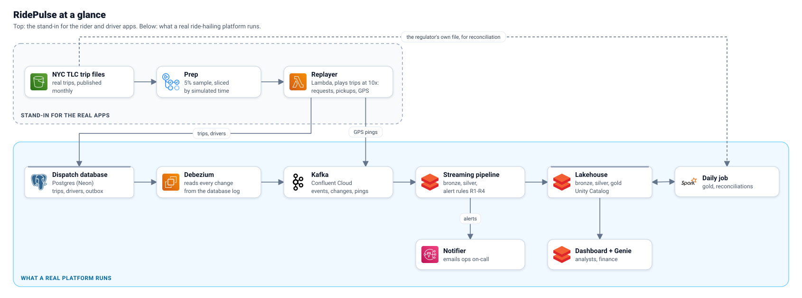

# RidePulse

**A ride-hailing operations and analytics platform for a fictional NYC operator, built on 61 million real trip
records.**

New York's taxi regulator publishes every Uber, Lyft and Via trip. RidePulse replays January 2025 through a dispatch
database as if it were happening now, at 10x: trips are requested, assigned and completed, and synthetic drivers
move and ping. The changes stream out of Postgres by CDC (Debezium) into Kafka, and a Databricks lakehouse turns them
into live ops alerts within minutes:
- a surge with no drivers;
- long waits;
- an airport queue;
- an app outage.

The same platform builds a daily star schema and reconciles it against the regulator's own file and the payouts.
Everything is code: Terraform, Databricks Asset Bundles, contracts, tests, and a gated deploy.

It runs on free tiers (Databricks Free Edition, Neon, Confluent Basic, AWS) for a few dollars a month. Every place where
that falls short of production is written down, with the reason and the production design
([the production design](docs/index.html#production)).

How to read it: the **top box stands in for the rider and driver apps** a real company would have. It replays real
TLC trips through the dispatch database as if they were happening now. Everything in the box below is what a real
ride-hailing platform runs: the dispatch database, CDC into Kafka, the lakehouse, and the alerts.



Everything else, from requirements and every layer to the 15 architecture decisions, runbooks, cost and the production
design, is one page with all the diagrams: [docs/index.html](docs/index.html) (English) and
[docs/index.vi.html](docs/index.vi.html) (Vietnamese). Open it in a browser; the section links below point into it.

## Results

All measured, on real runs. The evidence is linked.

| What | Result | Evidence |
|---|---|---|
| Surge alert latency, request commit in Postgres to email | R1 p50 **15.2 min**, p95 **19.1 min** (R3 p95 18.1; R2 27.2, waiting its join by design). Free Edition's ~20-minute limit per pipeline update rules out continuous mode; the 12-minute target is the production one | [alert latency](docs/index.html#alert-latency), [ADR-0008](docs/index.html#adr) |
| Injected incidents detected | **8 of 8**, each in its first window: stadium surges, app outages, late pings. False alarms on clean windows: R1 1.2%, R2 1.1%, R4 0.1% | [the four rules](docs/index.html#rules) |
| Debezium killed, replication slot dropped | **0 events lost or repeated** after recovery | [drills](docs/index.html#drills) |
| Log-based vs query-based CDC | Debezium saw **76 of 76** planted changes; a cursor-based pull **56 of 76** (no intermediate versions, no deletes) | [two CDC paths](docs/index.html#paths) |
| Silver against the dispatch database | **Equal:** 293,213 events, 2,834 drivers, none missing, extra or repeated | [rebuild runbook](docs/index.html#rb-rebuild) |
| Stream against the regulator's file | every replayed trip found once in the TLC file, copies excluded; the BCF within 2% a day, flat fees exact | [reconciliations](docs/index.html#recon) |
| Platform rebuilt from code (Debezium destroyed with its slot) | healthy end to end in **12.5 min**, target 30 | [rebuild runbook](docs/index.html#rb-rebuild) |
| A table onboarded to CDC with its existing rows | **27 of 27** rows by incremental snapshot, none quarantined | [onboarding runbook](docs/index.html#rb-onboard) |
| Driver data outside ops | **0 driver ids** visible to a finance user; own rows only for a driver; silver, bronze and ops denied | [security](docs/index.html#security) |
| Cost | **$0.95** billed for November 1-8 (AWS). The surprise was Kafka capacity, now capped: ~$50/month avoided | [cost](docs/index.html#cost) |

What went wrong along the way is written down too, for example a 36-hour stretch with no alerts:
[postmortem](docs/index.html#postmortem).

## How it's built

| Layer | What | Where |
|---|---|---|
| Contracts | trip key and replay sample, event schemas (JSON Schema, Avro), the TLC data contract, the CDC table registry | `contracts/`, `config/` |
| Source | replayer and dispatch schema with an outbox (Postgres), monthly prep | `services/`, `db/` |
| CDC and transport | Debezium Server (outbox router, incremental snapshots), Kafka topics, ACLs and schemas | `infra/terraform/debezium`, `infra/terraform/confluent` |
| Lakehouse | one streaming pipeline (bronze, silver, supply, rules), file ingest, the daily gold job, views | `databricks/` |
| Serving | AI/BI dashboard, Genie space, a metric view | `databricks/src/bi/` |
| Platform | AWS (Lambdas, S3, SNS, EventBridge), Databricks identities and grants, CI and gated deploys | `infra/terraform/`, `.github/workflows/` |
| Documentation | requirements, design, 15 ADRs, runbooks, a postmortem and the build history, in one page (English and Vietnamese) | `docs/` |

Quality gates on every PR:
- lint, unit, Spark and Postgres tests, and pyright;
- a real Postgres-Debezium-Kafka test;
- secret, infrastructure and dependency scans;
- Terraform plans.

A merge deploys stg, smoke-tests it, and waits for an approval before anything live changes
([break-glass](docs/index.html#rb-break-glass)).

## Run it

Prerequisites: an AWS account with an SSO profile `ridepulse`, a Databricks workspace with a CLI profile `ridepulse`,
a Neon project, a Confluent Cloud account, Terraform 1.17, and `uv`. Setting up a machine is in
[setting up a laptop](docs/index.html#setup).

```bash
make bootstrap-plan && make bootstrap-apply   # state bucket, GitHub OIDC roles, budget (once)
make landing-plan && make landing-apply       # the landing bucket
make confluent-plan && make confluent-apply   # topics, ACLs, schemas
make db-migrate && make db-seed              # the dispatch schema, zones, fare rules
make land-month MONTH=2025-01                 # one TLC month, pinned to its ETag (also land-zones, land-noaa)
make prep MONTH=2025-01                       # contract check, 5% sample, event-time slices
make replayer-plan && make replayer-apply     # replayer, notifier, the window Lambda
make debezium-plan && make debezium-up        # Debezium; let its first boot finish
make catalog                                  # the Databricks catalog (once); the bundle comes from CI

make replay DATE=2025-01-08                   # start the simulated clock
make up                                       # open a demo window: Debezium, replayer, pipeline, alerts
make window-status
make down                                     # close it
```

After that, changes go through a PR: a merge deploys stg and, after an approval, the live environment.

## Data

Real: NYC TLC trip records and zones, NOAA daily weather. Synthetic: the drivers, their pings, the dispatch
timeline, injected incidents and payout files. Which versions, and what exactly is made up:
[the data](docs/index.html#data). Trip data: NYC Taxi and Limousine Commission, via NYC Open Data.
