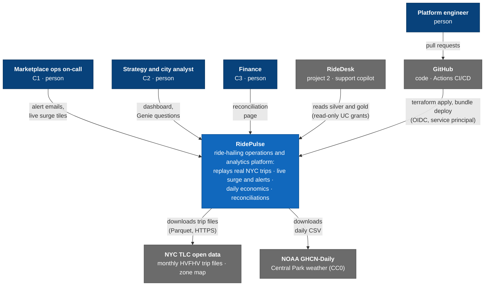
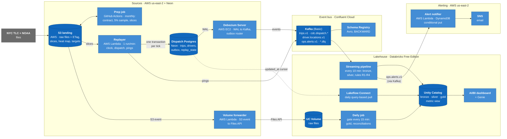
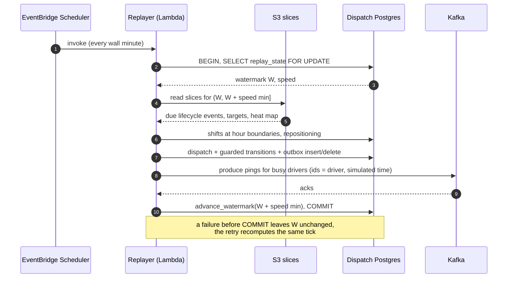
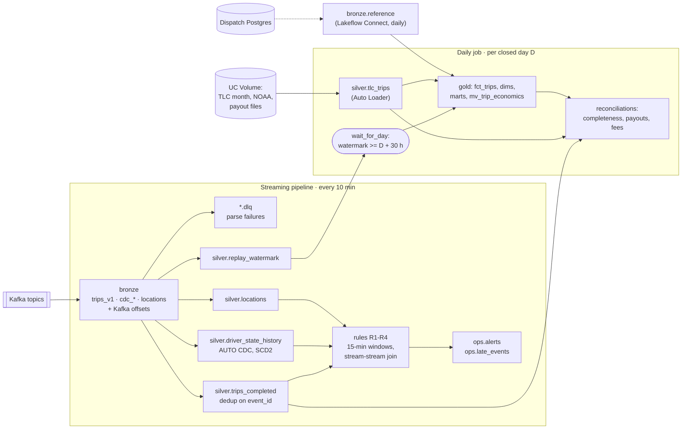

# RidePulse architecture (C4)

- Status: draft for review (Phase 1, step 6)
- Date: 2026-10-29
- Levels: 1 context, 2 containers, 3 components for the two parts with the most logic (the replayer
  tick and the lakehouse). This is the Free Edition build; the paid design is in
  [`production.md`](../production.md).
- Decisions behind it: ADR-0001 (platforms, us-east-2), ADR-0002 (secrets, identities), ADR-0003
  (supply), ADR-0004 (clock); data models in [`erd.md`](erd.md); numbers in [`sizing.md`](sizing.md).

## Level 1: system context

## Level 2: containers

| Container | Runs | Owns | Cost driver |
|---|---|---|---|
| Prep job | once per TLC month (GitHub Actions; EC2 if it outgrows 7 GB RAM) | the contract check, quarantine, sample, event-time slices, heat map, staffing targets | none |
| Replayer | EventBridge Scheduler, every wall minute, only in demo windows | the simulated clock (`replay_state`), dispatch, shifts, repositioning, pings | Lambda free tier |
| Dispatch Postgres | Neon Free, 0.25 CU | the source of truth for trip and driver state (48 simulated hours) | egress: 5 GB/month cap |
| Debezium Server | EC2, created and destroyed with demo windows | WAL position, outbox routing to `trips.v1`, table CDC | EC2 hours, public IPv4 |
| Kafka + Schema Registry | Confluent Basic | event transport, 1-7 day retention, schemas | GB in and out |
| Streaming pipeline | Lakeflow pipeline, `availableNow` every 10 min | bronze, silver, SCD2 driver state, rules, alerts | Free Edition daily quota |
| Lakeflow Connect | daily | the reference tables and the path B vs C comparison (ADR-0005) | quota |
| Daily job | gate every 15 min; real work once per closed day | gold, marts, three reconciliations | quota |
| Alert notifier | Lambda triggered by `ops.alerts.v1` | sending each alert once (DynamoDB conditional put) | free tier |
| Volume forwarder | Lambda on S3 events | copying files into the UC Volume (Free Edition can't read our bucket) | free tier |
| SSM Parameter Store | AWS | every non-AWS secret; Debezium renders its config from it at start, the Databricks secret scope is copied from it (ADR-0002) | free |

## Level 3: the replayer tick

One run of the replayer Lambda, as ADR-0003 and ADR-0004 define it. Every step is deterministic, so
a retried or overlapping run changes nothing.

## Level 3: the lakehouse

## Open points for later phases

- **Alert notifier trigger (Phase 3).** A Lambda event source on Confluent with SASL/PLAIN keeps its
  credentials in Secrets Manager, not SSM (ADR-0002 names SSM as the single source). Decide between a
  Secrets Manager copy derived from SSM, or a small poller on the schedule that already runs.
- **Prep job host (Phase 2).** GitHub Actions runners have about 7 GB RAM; the prep job reads one row
  group at a time. Measured on Actions for January 2025: 1.5 GB peak, 4 min 3 s, so Actions is
  enough.
