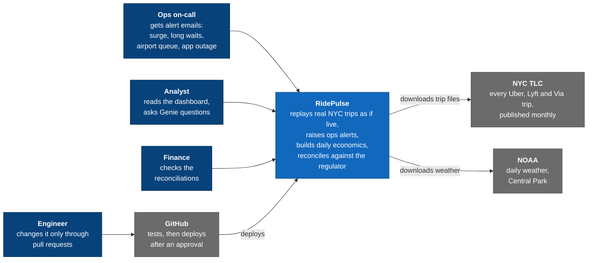
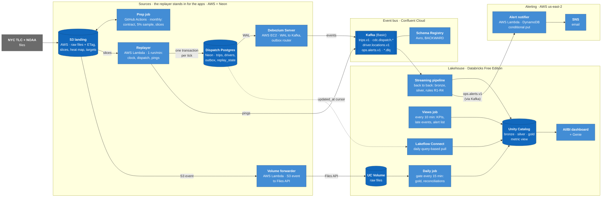
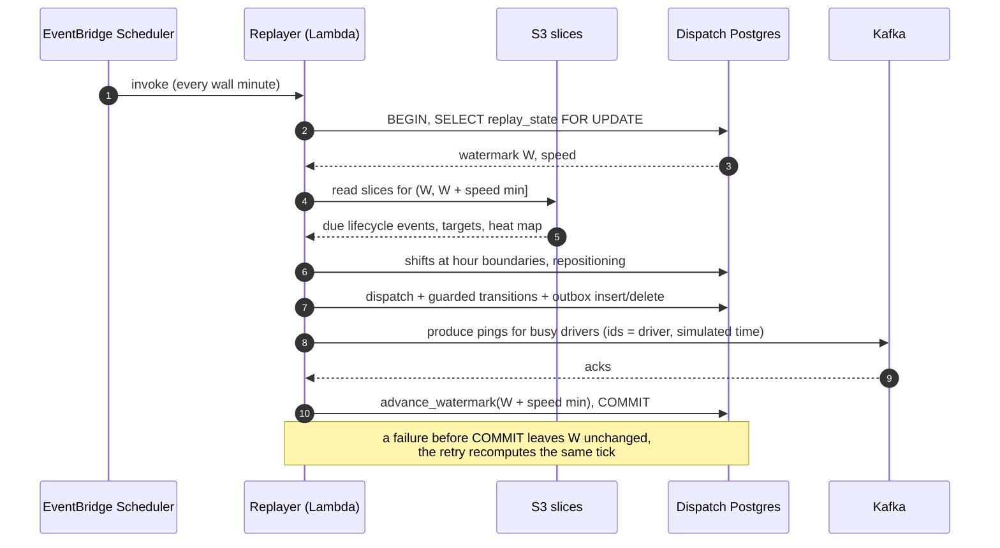
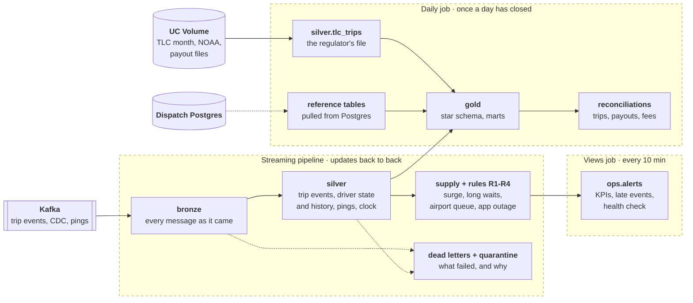

# RidePulse architecture (C4)

- Status: draft for review (Phase 1, step 6)
- Date: 2026-10-29
- Levels: 1 context, 2 containers, 3 components for the two parts with the most logic (the replayer
  tick and the lakehouse). This is the Free Edition build; the paid design is in
  [`production.md`](../production.md).
- Decisions behind it: ADR-0001 (platforms, us-east-2), ADR-0002 (secrets, identities), ADR-0003
  (supply), ADR-0004 (clock); data models in [`erd.md`](erd.md); numbers in [`sizing.md`](sizing.md).

## Level 1: system context

How to read it: RidePulse is the box in the middle. On the left, the people who use it and what each gets from it; on
the right, the public data it downloads. Nothing here is technology yet: that's Level 2.

## Level 2: containers

How to read it: the same system opened up, one box per thing that runs, grouped by where it runs. In **Sources**, the
replayer and its prep stand in for the rider and driver apps a real company has; everything from the dispatch
database on is what a real platform runs. Arrows are data moving; the dashed one is the second, query-based CDC path
kept for comparison (ADR-0005).

| Container | Runs | Owns | Cost driver |
|---|---|---|---|
| Prep job | once per TLC month (GitHub Actions; EC2 if it outgrows 7 GB RAM) | the contract check, quarantine, sample, event-time slices, heat map, staffing targets | none |
| Replayer | EventBridge Scheduler, every wall minute, only in demo windows | the simulated clock (`replay_state`), dispatch, shifts, repositioning, pings | Lambda free tier |
| Dispatch Postgres | Neon Free, 0.25 CU | the source of truth for trip and driver state (48 simulated hours) | egress: 5 GB/month cap |
| Debezium Server | EC2, started and stopped with demo windows (destroyed only to rebuild, `rebuild.md`) | WAL position, outbox routing to `trips.v1`, table CDC | EC2 hours, public IPv4 |
| Kafka + Schema Registry | Confluent Basic, capped at one eCKU | event transport, 1-7 day retention, schemas | capacity (eCKU-hours), then GB in and out (`cost.md`) |
| Streaming pipeline | Lakeflow pipeline, triggered updates back to back (a 1-minute schedule, one at a time; no update may run ~20 min on Free Edition, ADR-0008) | bronze, silver, SCD2 driver state, supply, rules, alerts | Free Edition daily quota |
| Views job | a job task every 10 minutes, in demo windows (#25) | the views recomputed in full: KPIs, late events, the alert list, DQ rates; the platform health check | quota |
| Lakeflow Connect | daily | the reference tables and the path B vs C comparison (ADR-0005) | quota |
| Daily job | gate every 15 min; real work once per closed day | gold, marts, three reconciliations | quota |
| Alert notifier | Lambda polling `ops.alerts.v1` every minute, only in demo windows | sending each alert once (DynamoDB conditional put) | free tier |
| Volume forwarder | Lambda on S3 events | copying files into the UC Volume (Free Edition can't read our bucket) | free tier |
| SSM Parameter Store | AWS | every non-AWS secret; Debezium renders its config from it at start, the Databricks secret scope is copied from it (ADR-0002) | free |

## Level 3: the replayer tick

One run of the replayer Lambda, as ADR-0003 and ADR-0004 define it. Every step is deterministic, so
a retried or overlapping run changes nothing.

## Level 3: the lakehouse

How to read it: data enters on the left and moves right.
- **Bronze** keeps every message exactly as it arrived.
- **Silver** is checked against the contracts, typed and deduplicated. A message that can't be parsed goes to a
  dead-letter topic; a record that fails a check goes to quarantine with the reason (the dashed arrows).
- **Gold** is the daily star schema people query.

The three dashed boxes are the jobs that run each part. The alerts the rules raise also go back to Kafka, where the
notifier emails them (Level 2).

## Open points for later phases

- **Alert notifier trigger (Phase 3): decided.** A poller on a one-minute schedule that reads SSM, not a Lambda
  Kafka trigger, which would need Secrets Manager (ADR-0002, amendment 1, #22).
- **Prep job host (Phase 2).** GitHub Actions runners have about 7 GB RAM; the prep job reads one row
  group at a time. Measured on Actions for January 2025: 1.5 GB peak, 4 min 3 s, so Actions is
  enough.
