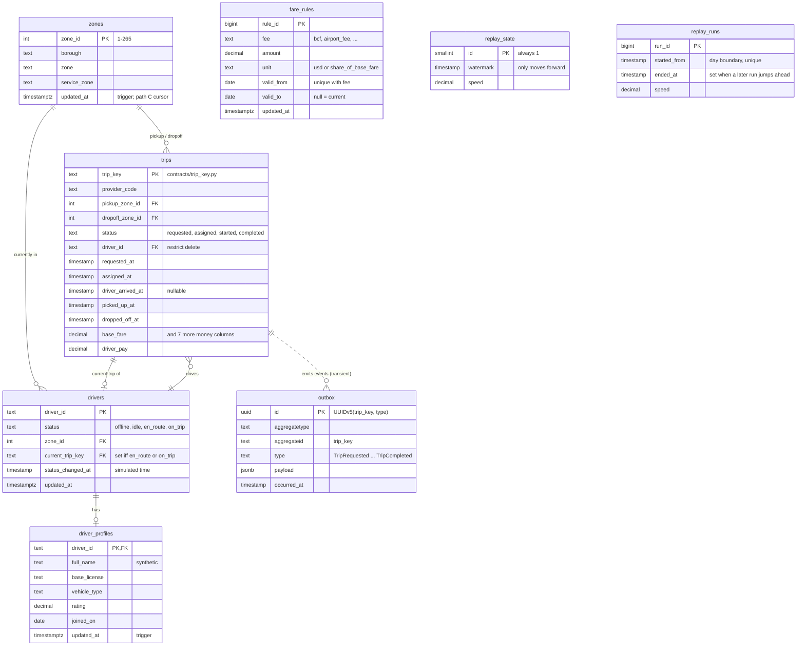
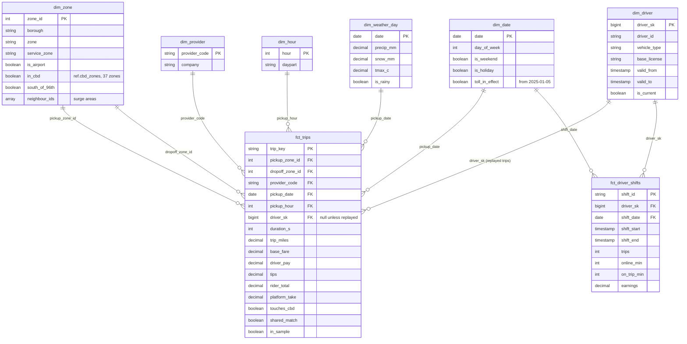

# RidePulse data models (ERDs)

- Status: draft for review (Phase 1, step 4)
- Date: 2026-10-29
- Two models on purpose: a **normalized, write-optimised dispatch schema** in Postgres (what a ride
  app's backend would own) and a **star schema** in gold (what analysts and Genie query).
- The dispatch schema is real code: [`db/migrations/V001__dispatch.sql`](../../db/migrations/V001__dispatch.sql),
  and V002 (`replay_runs`), applied by `db/migrate.py` and proven by the SQL tests in `db/tests/`
  (run in CI against Postgres 18 and on Neon with `make db-test`).

## 1. Dispatch database (Neon Postgres)

### Rules the schema enforces (each one is tested)

| Rule | How | Why |
|---|---|---|
| A trip is inserted once | `trip_key` primary key + `ON CONFLICT DO NOTHING` | Lambda retries and overlapping runs |
| Transitions only move forward | each `UPDATE` names the state it expects (`WHERE status = 'requested'`) | a replayed minute matches 0 rows |
| An event exists only if the state changed | the outbox `INSERT` selects from the `UPDATE ... RETURNING` | no event without a transition |
| The outbox is empty at rest | insert and delete in the same transaction; the WAL keeps the insert | Debezium's Outbox Event Router publishes it to `trips.v1` |
| A state can't lie | `CHECK`s: assigned needs a driver; started needs a pickup time; completed needs dropoff, fare and pay; dropoff >= pickup | the stream carries only consistent trips |
| Driver status matches its trip | `en_route`/`on_trip` iff `current_trip_key` is set | supply counts are exact |
| The watermark never goes back | `advance_watermark()` with `greatest()` | the daily gate can't reopen a closed day |
| `updated_at` is the database's | `BEFORE UPDATE` triggers overwrite any value the writer sends | path C's cursor sees every edit |
| History keeps its driver | `trips.driver_id` restricts deletes; a leaving driver goes `offline` | the planted hard delete targets a **profile**, not a driver |
| Debezium reads 5 tables, never `trips` | explicit publication `ridepulse_cdc` | Neon egress (sizing §4) |
| A replay starts or jumps only forward, at a day boundary | `start_replay()` (V002); `replayed_days` view | the gate and completeness skip days the stream never saw (ADR-0004 §8) |

The test found one design contradiction before any code depended on it: deleting a driver was
first set to blank the driver on past trips, which the "assigned needs a driver" rule then rejected.
The fix is the "history keeps its driver" row above.

### Normalization and choices
- Third normal form, except the money columns on `trips`, which are the real TLC values copied
  once at completion (there is no pricing logic to normalise).
- `timestamp` (no time zone) for simulated business times, like the TLC data; `timestamptz` only for
  the database's own `updated_at`.
- Ids are text (`D0001`, sha256 keys) to stay readable in CDC events.

## 2. Gold (Databricks, star schema)

Grain first, then keys. Primary and foreign keys are declared as Unity Catalog informational
constraints so Genie can join facts to dimensions itself, instead of a flat "one big table" copy.

| Table | Grain | Built from | Type |
|---|---|---|---|
| `fct_trips` | one row per trip | `silver.tlc_trips` (full months) + driver from `silver.trips_completed` for replayed trips | fact |
| `fct_driver_shifts` | one row per driver shift | driver state history | fact |
| `dim_zone` | one row per TLC zone (265) | TLC zone lookup + `ref.cbd_zones` + adjacency | SCD1 |
| `dim_provider` | one row per licence | 4 HV licences | static |
| `dim_driver` | one row per driver version | path B (`cdc.dispatch.driver_profiles`), which sees every update and delete | **SCD2** |
| `dim_date`, `dim_hour` | calendar | generated | static |
| `dim_weather_day` | one row per day | NOAA GHCN-Daily, Central Park | append |

Marts on top (grain in the name): `agg_zone_hourly` (zone x hour), `agg_daily_economics` (day),
`agg_driver_weekly` (driver x week, row-filtered), `agg_cbd_impact` (period x zone group),
`agg_recon_daily` (day x reconciliation).

### The metric view for Genie: `mv_trip_economics`

Source `fct_trips` joined to `dim_zone` (pickup), `dim_provider`, `dim_date`, `dim_hour`,
`dim_weather_day`. Ratios are defined as **ratios of sums**, so Genie can't average a ratio:

| Measure | Definition |
|---|---|
| trips | `count(1)` |
| gmv | `sum(rider_total)` |
| driver_pay | `sum(driver_pay)` |
| **take_rate** | `1 - sum(driver_pay) / sum(base_fare)` (plan: ≈ 20-24%) |
| tip_rate | `sum(tips) / sum(base_fare)` |
| avg_duration_min | `sum(duration_s) / count(1) / 60` |

Dimensions: borough, zone, service zone, provider, date, day of week, weekend, hour, daypart,
`touches_cbd`, `toll_in_effect`, `is_rainy`. Phase 0 test S4 proved metric views and Genie answer
correctly on Free Edition.

## 3. How the two models connect

| Dispatch (Postgres) | Path | Gold |
|---|---|---|
| `outbox` events | Debezium Outbox Event Router -> `trips.v1` -> silver `trips_completed` | `fct_trips.driver_sk` for replayed trips; completeness reconciliation |
| `drivers` | Debezium CDC -> `cdc.dispatch.drivers` -> SCD2 driver state | `fct_driver_shifts`, supply in the rules |
| `driver_profiles` | Debezium CDC (path B) **and** Lakeflow Connect (path C) | `dim_driver` from path B; path C only for the ADR-0005 comparison |
| `zones`, `fare_rules` | Lakeflow Connect (path C) | `dim_zone`; fee rates for the fees reconciliation |
| `replay_state` | Debezium CDC | the daily gate (requirements §2) |
| `replay_runs` | Debezium CDC | which days the gate and completeness consider (ADR-0004 §8) |
| `trips` | **not streamed** | the official TLC file is the source of `fct_trips` |
