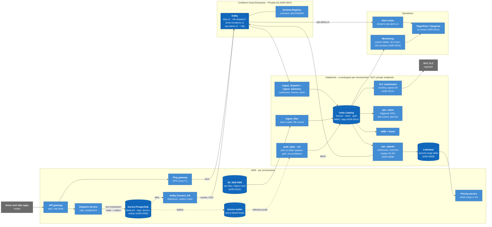

# RidePulse in production

- Status: **skeleton** (Phase 1, step 6). Finished in Phase 7 (hardening), with measured costs and
  the results of the Pro sprint.
- Question it answers: if a real ride-hailing operator ran RidePulse, what would change, what would
  stay, and what would it cost?
- The Free Edition build is in [`design/c4.md`](design/c4.md); its numbers in
  [`design/sizing.md`](design/sizing.md).

## 1. What changes

Each row is a deliberate difference. The rule is **one ADR per difference**: the "ADR" column names
the record that explains it. Geography stays a stretch goal (S-D), and GenAI is RideDesk's (project 2).

| Concern | This project (Free Edition) | Production (paid) | ADR |
|---|---|---|---|
| Event source | A replayer turns historical TLC trips into events; 5% sample; synthetic drivers and pings | Driver and rider apps at full volume through an API gateway; trips written by the dispatch service | ADR-0003, ADR-0004 |
| Supply | Synthetic pool (~3,100), demand-shaped shifts, zone-level repositioning | Real driver app state and GPS | ADR-0003 |
| Time | A simulated clock: replay watermark in `replay_state`, days close at D + 30 h | Wall clock; Spark event-time watermarks alone; the daily job runs on the calendar with a late-data allowance | ADR-0004 |
| Source database | Neon Free Postgres, 0.25 CU, 48 simulated hours hot | Aurora PostgreSQL Multi-AZ; a read replica for query-based loads; migrations checked against contracts in CI | [ADR-0006](adr/0006-source-database.md) |
| CDC | Debezium Server on one ephemeral EC2, offsets on disk, demo windows only | HA Kafka Connect (MSK Connect or Confluent's managed Debezium), offsets in Kafka, alerts on slot lag and WAL size; reference data by query-based loads from a read replica | ADR-0005 |
| Kafka and network | Confluent Basic over the public internet, ACLs | MSK or Confluent Dedicated over PrivateLink; RBAC per service; NCC for serverless egress | [ADR-0007](adr/0007-kafka-and-network.md) |
| Streaming latency | Triggered runs back to back (~10.5 min each, 3 of them starting up); the full-recompute views in a separate 10-minute job. Measured (#25): surge alert p95 19.1 min from request commit to email. Continuous mode ran, but Free Edition lost the serverless driver ~20 min into every update, continuous or not, so no update may run that long | Continuous pipelines or real-time mode for the rules (p95 <= 12 min was the plan's target, and a paid workspace's to meet); surge recomputed every few seconds | [ADR-0008](adr/0008-streaming-latency.md) |
| Serving surge | A Delta table and a dashboard tile | A low-latency store (Lakebase synced tables or a cache) read by the pricing service in milliseconds | [ADR-0009](adr/0009-serving-surge.md) |
| Geography | 265 TLC zones, centroids, polygon adjacency (`ref/`) | H3 hexagons at several resolutions, GPS map-matching, surge per hexagon | stretch S-D |
| Files | S3 landing, a forwarder Lambda copies into a UC Volume (Free Edition can't read our bucket) | An S3 bucket per environment with SSE-KMS and lifecycle rules; external locations; Auto Loader file events | [ADR-0010](adr/0010-file-ingestion.md) |
| Environments | One workspace; a catalog per environment (`ridepulse_dev`, `ridepulse_stg`) | A workspace per environment under one metastore | ADR-0001 |
| Identity | GitHub OIDC to AWS; service principal `ridepulse-ci` with OAuth M2M (90-day secret) | OIDC federation to Databricks too (no stored secret); SCIM groups; on-behalf-of auth in apps | ADR-0002 |
| Secrets | SSM SecureString as the single source; copies derived | Same model, plus a CMK and rotation automation | ADR-0002 |
| Infrastructure as code | Workspace-level Terraform + Asset Bundles; catalogs created with SQL (Default Storage only) | Account-level Terraform as well: workspaces, metastore, network, storage credentials | [ADR-0011](adr/0011-infrastructure-as-code.md) |
| Alerting | SNS email, sent once (DynamoDB conditional put) | PagerDuty or Opsgenie with escalation; SLA alerts on the platform itself | [ADR-0012](adr/0012-alerting.md) |
| Regulatory reporting | The TLC file is an input | The platform produces the monthly TLC submission, with a contract, completeness checks and an audit trail | [ADR-0013](adr/0013-regulatory-reporting.md) |
| Privacy | No identities exist; synthetic driver ids are masked outside ops and row-filtered all the same (#38, docs/security.md) | Precise location is sensitive: retention limits, aggregation, tokenized ids, access audits | [ADR-0014](adr/0014-privacy.md) |
| Quality, security, cost | Contract checks with quarantine and DQ rates per provider (built); grants, an ABAC mask on driver ids and a row filter (#38); AWS budget alerts at $5 | Plus data quality monitoring, audit logs, ABAC, budget policies, `system.billing` dashboards | [ADR-0015](adr/0015-quality-security-cost.md) |
| GenAI | Not in RidePulse: the support copilot is RideDesk (project 2), reading RidePulse's silver and gold | Same split; AI Gateway in front of models | RideDesk plan |

### Alert latency in production (SLA-1)

This project measured surge alerts at **p95 19.1 min** from request commit to email (#25). That is a Free Edition
number: a triggered run takes ~10.5 min, 3 of them starting compute, and no update may run past ~20 min, so
continuous mode isn't possible. An operator needs much less, and pays for it.

**What an operator would set.** These are targets to prove in the Pro sprint (§5), not measurements.

| Signal | Who acts on it | Target | Why |
|---|---|---|---|
| Surge multiplier for pricing (R1's ratio) | The pricing service, automatically | p95 <= 30 s from request to multiplier | A price minutes old is set for demand that has moved on |
| Ops page: surge with no supply, airport shortage (R1, R3) | Dispatch on call | p95 <= 2 min, max 5 min, to the pager | Time to move drivers before riders give up |
| Long waits (R2) | Dispatch on call | p95 <= 5 min after a rider has waited past the limit | Alert on the wait as it happens, not after the pickup |
| App outage (R4) | Engineering on call | p95 <= 2 min from the first silent minute | An outage costs every trip in the borough |
| Platform: alert path late or down | Data platform on call | page within 5 min of SLA-1 burning its budget | The alerts' own latency is watched, not assumed |

Written as SLOs: e.g. 99% of R1 alerts within 2 min over 28 days, with an error budget that pauses risky changes when
it's spent.

**How to set it up**

1. **Compute: no per-run startup.** A paid workspace, with the alerting flows (bronze, silver, supply, R1-R4, the
   Kafka sink) in a **continuous** Lakeflow pipeline. The surge signal runs in Structured Streaming **real-time
   mode**, for sub-second micro-batches. The views recomputed in full (KPIs, late-event rates, the alert list)
   go to their own triggered pipeline or job, as here, so they never hold up an alert.
2. **Supply as a stream, not a recompute.** `ops.zone_supply` is rebuilt from all driver history on each run here.
   In production it's incremental state: driver state changes applied to per-zone counters as they arrive, kept
   in a low-latency store (Lakebase synced table or a cache) that pricing reads in milliseconds.
3. **R2 on timers.** Instead of waiting for the pickup (the 75-minute join hold-back), keep each open request in
   state with a timer (`transformWithState`) and alert when it passes the wait limit with no driver.
4. **R4 on driver heartbeats.** Apps send a heartbeat; per-driver liveness state with a timeout, rolled up per
   borough. The per-tick heartbeat here (#25) is the stand-in.
5. **Delivery: push, not poll.** The notifier consumes `ops.alerts.v1` as a stream (a Kafka event-source Lambda or
   a small always-on consumer), not a one-minute poll. It pages PagerDuty or Opsgenie with `alert_id` as the dedup key,
   and groups alerts by incident: one stadium set off ~18 overlapping surge areas per window here.
6. **Kafka and CDC sized for it.** MSK or Confluent Standard/Dedicated over PrivateLink. Topics partitioned by area or
   driver, so a hot zone doesn't block others. CDC on an HA Connect cluster with slot-lag alerts.
7. **Measure it all the time.** `scripts/measure/alerts.py latency` becomes a metric: commit time and `sent_at` on
   every alert, p95 per rule on a dashboard, and an alert when the SLO burns too fast.

**What it costs.** Continuous pipelines bill DBUs around the clock. That, a Kafka cluster and a paging tool are most
of §4's $1k+/month floor. Real-time mode and a low-latency store add to it, quoted in Phase 7.

### How the pipelines are split

**Here:** one streaming pipeline holds the whole path, 51 steps: three Kafka sources into bronze, their dead-letter
queues, silver for every source, the reference tables, supply, the four rules, and the alert sinks back to Kafka.
Batch work (gold, file ingestion, the 10-minute views) runs as separate jobs. The reason is Free Edition: one active
pipeline per type, and the alerts need every layer moving at once.

**What one pipeline costs.**

- **Blast radius:** a failure in one flow fails the update, so every other flow waits for the next one. A
  `DUPLICATE_SOURCE_NAMES` in R4 delayed the trip events and pings as well (four times, 2026-11-07/08).
- **Deploys:** any change replans all 51 steps; a change to R2 is a deploy of bronze too.
- **Sizing:** compute is sized for the whole graph, not for what each part needs.
- **Refresh:** a full refresh is chosen per table (`full_refresh_selection`); getting the selection wrong resets more
  than intended.
- **Ownership:** no team can own a part of it.

**In production**, split by domain and by latency tier. Each pipeline publishes Unity Catalog tables that are the
contract with the next one, and reads its inputs as streams from those tables, not from inside one graph:

| Pipeline | Contents | Mode | Owner | Target |
|---|---|---|---|---|
| `ingest_dispatch` | Kafka `trips.v1` and `cdc.dispatch.*` into bronze, DLQs, then silver trip events and driver state with quarantine | continuous | data platform | silver within 1 min of the commit |
| `ingest_telemetry` | Kafka `driver.locations.v1` into bronze and silver pings; partitioned by driver, the busiest stream | continuous | data platform | silver within 30 s |
| `ops_signals` | supply as incremental state, R1-R4, the alert sinks; real-time mode for the surge signal (§1 above) | continuous | dispatch ops | §1's SLOs |
| `ops_views` | KPIs, late-event rates, the alert list, DQ rates | triggered every few minutes | dispatch ops | 5 min |
| `ingest_files` | Auto Loader for TLC, NOAA and partner files into bronze and silver | triggered on file arrival | data platform | SLA-6 |
| `gold_daily` | the star schema, marts and reconciliations for each closed day | a job, triggered when the day's silver tables update | analytics | SLA-3/4 |
| `ref` | zones, rules, fare rules from the source systems | a job, on change | data platform | daily |

**How the pieces fit.**

- **Across pipelines, tables are the interface.** Silver tables are data products with contracts (`contracts/`),
  owners and schema evolution rules. Downstream pipelines read them as streams, so splitting adds no latency beyond
  a commit.
- **Orchestration:** Lakeflow Jobs with table-update triggers rather than clocks. A downstream job runs when its
  inputs change, and lineage in Unity Catalog shows the chain end to end.
- **Monitoring:** each pipeline's event log goes into the system tables, with alerts per pipeline on flow failures,
  backlog (Kafka consumer lag) and freshness against its target. A failing `ops_signals` pages dispatch ops, not the
  data platform.
- **Deploys:** one bundle, with each pipeline as its own resource. CI deploys only what changed, through dev, stg and
  prod workspaces with an approval before prod (#78). A rule change never replans ingestion.
- **Compute:** sized per pipeline. Ingestion autoscales with Kafka lag; `ops_signals` gets the low-latency
  configuration; the views and gold use cheaper triggered compute.
- **Recovery:** a full refresh is scoped to one pipeline. Bronze is never refreshed: it keeps the history to rebuild
  silver from (Kafka retention is days; bronze is the replay log).

**Moving there from this project.** The code is already split along these lines:
- **Separate source files:** `bronze/pipeline.py`, `silver/silver.py`, `ops/supply.py` and `ops/rules.py`, with the
  logic in testable modules (#76).
- **Fully qualified reads across layers:** every read from one layer to the next already uses a full table name
  (`ridepulse_dev.silver.locations`). Only views inside one file use short names, and they stay in the same pipeline.

What's left:
- **Pipeline resources:** give each group its own pipeline resource in the bundle.
- **Checkpoints:** each moved table's flow starts in the new pipeline with a new checkpoint. Bronze would re-read
  Kafka from its retention, and silver dedupes. This is the same mechanism as the bronze flow suffix that #98 adds for
  a new Kafka cluster.

It's configuration, not a rewrite.

### Containers in production (C4 level 2)

The same system as [`c4.md`](design/c4.md)'s level 2, with each difference above applied. Everything sits in private
networks; arrows across accounts go over PrivateLink. The pipeline split follows "How the pipelines are split" (§1).

| Container | Replaces here | Owner |
|---|---|---|
| API gateway, dispatch service, ping gateway | the replayer Lambda and its prepared slices | product engineering |
| Aurora PostgreSQL and its reader | Neon Free | product engineering |
| Kafka Connect (HA) | Debezium Server on one EC2 instance | data platform |
| Confluent Enterprise over PrivateLink | Confluent Basic over the internet | data platform |
| The seven pipelines and jobs | one streaming pipeline and three jobs | data platform, dispatch ops, analytics |
| Lakebase synced surge table | a Delta table read by a dashboard | dispatch ops |
| TLC submission | the TLC file as an input | finance and compliance |
| Alert router and incident tool | the polling notifier Lambda, SNS email | dispatch ops, data platform |

## 2. Scale at 100% of trips

Sizing at the full volume: measured here where it says so, and x 20 of this project's measurements otherwise
(the replay is a 5% sample). Measured 2026-11-08 over 10.3 simulated days (2024-12-31 to 2025-01-11).

| Quantity | This project | Production | Note |
|---|---|---|---|
| Trips per day | ≈ 33k (5% sample), max 39.6k | ≈ 661k, max ≈ 790k | |
| Lifecycle events per day | ≈ 132k, max 159k | ≈ 2.6M, max 3.2M | 4 per trip |
| Drivers busy at the peak | 1,392 (synthetic) | ≈ 28k | from ADR-0003's simulation, x 20 |
| Pings | ≈ 2.9M/simulated day, busy drivers every 15 s | real apps: ~80k active drivers every 4 s ≈ 20k/s at peak, 100-300 GB/day raw | plan estimate |
| Dispatch database | < 100 MB | tens of GB hot; WAL and CDC throughput become the constraint | |
| Kafka | ≈ 470 MB/simulated day estimated; peak ~24 requests/s and 0.05 MB/s in (measured, 2026-11-06) | ≈ 100-300 GB/day, pings dominate | partitions: 48 for pings, 12 for trips and CDC (ADR-0007) |
| Bronze, streaming | measured: 290 MB for 10.3 simulated days (28 MB/day), pings 71% | ≈ 0.6 GB/day at the same ping rate; 5-15 GB/day with app pings every 4 s | compressed Delta; raw pings kept 7 days (ADR-0014) |
| Silver, streaming | measured: 329 MB (32 MB/day) | ≈ 0.6 GB/day, more with app pings | |
| Silver, TLC file | measured: 1.4 GB per month (3 months, 61M trips) | the same: the file is already 100% | `silver.tlc_trips` |
| Gold | measured: `fct_trips` ≈ 1 GB per month | the same for the file's trips; the streamed share grows x 20 | marts are small (< 50 MB) |
| Pipeline compute | measured: 92 DBU for November 1-8 (demo windows only) | continuous, 24/7, split into pipelines (§1): to size by load test | list-price equivalent in §4 |

## 3. What stays the same (keeping the switch cheap)

These are rules for every phase, so the paid design is a configuration change, not a rewrite. The
status column is checked in Phase 7.

| Rule | Status now |
|---|---|
| Contracts don't depend on the source: the same Avro and JSON contracts whether the replayer or a real app produces an event | done: `contracts/events/` (JSON Schema), the ping Avro in Schema Registry, `tlc_trips.yaml` |
| No hard-coded environment: trigger, catalog, storage path, sample rate and replay speed are bundle variables | partly: catalog per target, replay speed a replayer argument; the sample rate is still a constant in `contracts/trip_key.py` (#80) |
| Debezium config is one file per environment | done: `infra/terraform/debezium/env/dev.properties` |
| Secrets only from SSM and secret scopes | done (ADR-0002) |
| Terraform modules take an edition flag (`free` / `paid`) | not yet (#80) |
| Every write is a `MERGE` or `REPLACE WHERE`, so backfills and reruns are safe | silver done (FR-15); gold in Phase 4 (#29, #33) |

## 4. What it costs

**This project, measured** (`docs/cost.md`, from each provider's billing data):

| Item | October | November 1-8 |
|---|---|---|
| Billed: AWS | $0.38 | $0.95 |
| Billed: Confluent, Databricks, Neon | $0 | $0 (Confluent's $10.34 of usage paid by the trial credit) |
| Databricks usage at list price (what a paid workspace would bill) | ~$24 | ~$72, of which pipelines $32 and SQL $21 |

The lesson for production pricing: the line that surprised was **capacity, not data**. Confluent billed eCKU-hours
for a load of ~24 requests/s, until it was capped. Every elastic service gets an explicit ceiling (ADR-0015).

**Production, plan estimates** (checked October 2026). Treat **$1k+/month** as a rough floor:

| Item | Monthly | Basis |
|---|---|---|
| Kafka: Confluent Enterprise over PrivateLink (ADR-0007) | from ≈ $385 (Standard's price) upward, plus ping volume | quote at the load-tested eCKU count |
| CDC: Connect cluster or managed connector | ≈ $76-152 or more | |
| PrivateLink endpoints | ≈ $7.30 per AZ-month each | |
| Aurora PostgreSQL Multi-AZ, a writer and a reader (ADR-0006) | to quote | sized from the dispatch write load at 100% |
| Databricks: continuous pipelines, jobs, SQL, serving (ADR-0008, ADR-0009) | to quote | this project's list-price usage is the per-hour basis for triggered work; continuous compute runs 24/7 instead of 3-hour windows |
| Incident tool and on-call (ADR-0012) | per seat | |

## 5. Rehearsal: the Pro sprint (stretch S-A)

A 14-day paid Databricks on AWS trial to rehearse the rows above that Free Edition can't show:
external locations on our own bucket, a workspace per environment, pipelines running around the
clock (Free Edition runs a continuous pipeline, but the daily quota keeps it to demo windows, #25), a
low-latency surge store, and system tables for cost. Results go into this document.

## 6. Where this build stops short of production

From a review against enterprise data-engineering patterns (2026-11-05). What can be built here is an issue;
what can't is said here, with the reason, so the gap is a known decision and not an oversight.

| Pattern | This project | Why it can't go further here | Production |
|---|---|---|---|
| Tests for pipeline code | Spark unit tests and a Postgres-Kafka-Debezium container test in CI (#76) | Lakeflow-only behaviour (AUTO CDC, Kafka sinks, continuous triggers) runs only on Databricks, and one Free Edition workspace leaves no throwaway test workspace: those keep a smoke run on stg | A test workspace per PR or per day, full end-to-end runs before promotion |
| Governance | Account groups (ops, finance, RideDesk), gold-only grants, an ABAC policy masking `pii`-tagged driver ids outside ops, a row filter so a driver sees only their own pay, all applied by the gold build (#38); checked as a non-ops principal. `system.access.audit` is there to query | No account console and no identity provider: account groups are made through the workspace's account SCIM endpoint by hand, and their members added the same way (#77 puts them in Terraform). The mask is NULL, not a token: a keyed token needs a key that can't sit in a function body in a public repo | IdP groups through SCIM, tokenized ids with a key in a secret store, audit logs reviewed and alerted on |
| Platform monitoring | Failure emails on the pipeline and jobs, platform alerts, an ops dashboard (#36) | Email is the only channel in budget. Data quality monitoring is to be checked on Free Edition (#36) | PagerDuty or Opsgenie with escalation; data quality monitors on every gold table |
| Security scanning | Secret scanning with push protection, `gitleaks` over the history, `trivy config` (accepted findings in `.trivyignore.yaml`, with why), `pip-audit`, Dependabot with a 14-day cooldown (#38) | Secret scanning's non-provider patterns and validity checks need GitHub Advanced Security | Plus SAST, signed build artifacts, and the GHAS checks |
| Environments and promotion | stg on merge, an end-to-end smoke, then dev and Terraform applies behind a GitHub environment approval (#78) | One workspace and one Confluent cluster: no separate prod. dev is the live environment, so promotion is stg to dev | A workspace and a Kafka cluster per environment; stg to prod with approval |
| Identity as code | Service principals, entitlements and grants in Terraform (#77) | Catalogs are created with SQL (Default Storage only, ADR-0001); no account-level resources or workload identity federation (ADR-0002) | Account-level Terraform: workspaces, metastore, catalogs on our own storage, federation instead of secrets |
| Onboarding sources | One registry each for CDC tables (#79) and file sources (#26); new gold tables filled by a full-range backfill (#33) | Nothing | Same |
| Streaming uptime | Continuous only inside a demo window, started and stopped by the window Lambda (#25) | The Free Edition daily quota, and the replayer budget (requirements §9) | 24/7, with real-time mode for surge |
| Paid switch | An edition flag in Terraform and the sample rate as config (#80) | Nothing | Same |

## 7. To fill in later

- [x] Phase 3: measured alert latency (SLA-1), and what production needs and how to set it up (§1, #25).
- [ ] Pro sprint (§5): continuous and real-time mode measured against the production targets in §1.
- [x] Phase 4: ADR-0005, path B (log-based CDC) vs path C (query-based) misses, measured (C saw 56 of 76 planted changes).
- [x] Phase 7 (#40): one ADR per row in §1 (ADR-0006 to ADR-0015); measured costs (§4, `docs/cost.md`); the scale
      table from measured sizes (§2); a production C4 container diagram (§1).
- [ ] The Pro sprint's results (§5), which need a paid workspace.
